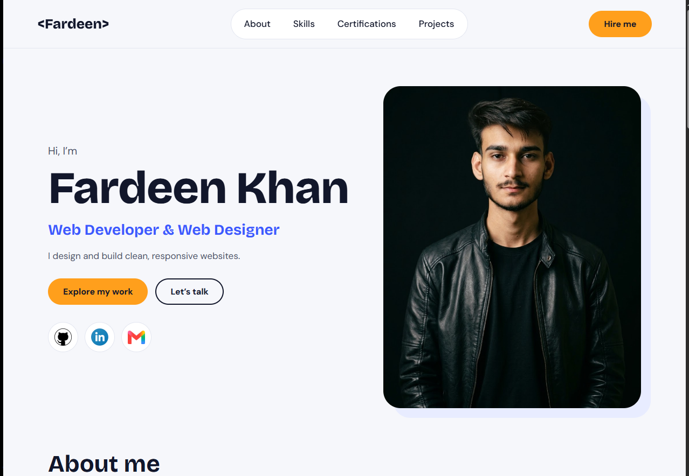

# Fardeen Khan | Portfolio Website

My personal portfolio website. I designed and coded it from scratch using HTML, CSS and JavaScript..

Live on vercel : https://fardeenkhan-portfolio-delta.vercel.app/

## Features

- Clean and modern light design
- Responsive layout: works on desktop, tablet and phone
- Sticky navigation bar with smooth scrolling
- Skill bars that fill when you scroll to them
- Certifications and projects shown in cards
- Social links: GitHub, LinkedIn and Gmail
- Working contact form (sends the message to my email)
- Shows "Message Sent" after sending, and the form clears itself

## Sections

- **Hero**: my name, role and social links
- **About me**: short introduction and quick facts
- **Skills**: HTML, CSS and JavaScript
- **Certifications**: my diploma and certificates
- **Projects**: my projects with screenshots and preview links
- **Hire me**: contact form

## Files

| File | What it does |
| --- | --- |
| `index.html` | All the content and structure of the website |
| `style.css` | All the styling and responsive design |
| `script.js` | Skill bar animation and the contact form |
| `Assets/` | Images and logos used in the website |

## Built With

- HTML
- CSS
- JavaScript
- Web3Forms (for the contact form)
- Google Fonts (Bricolage Grotesque and DM Sans)

## Contact

- GitHub: [fardeenkhannaveed](https://github.com/fardeenkhannaveed)
- LinkedIn: [Fardeen Khan](https://www.linkedin.com/in/fardeen-khan-aa3631446/)
- Email: fardeenkhannaveed@gmail.com
